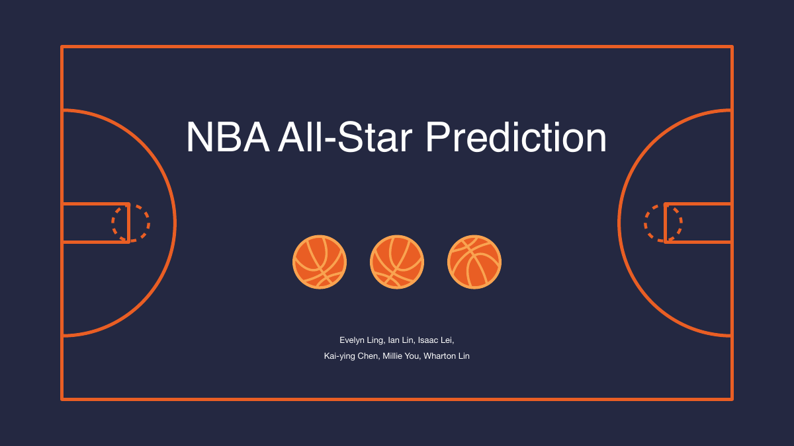
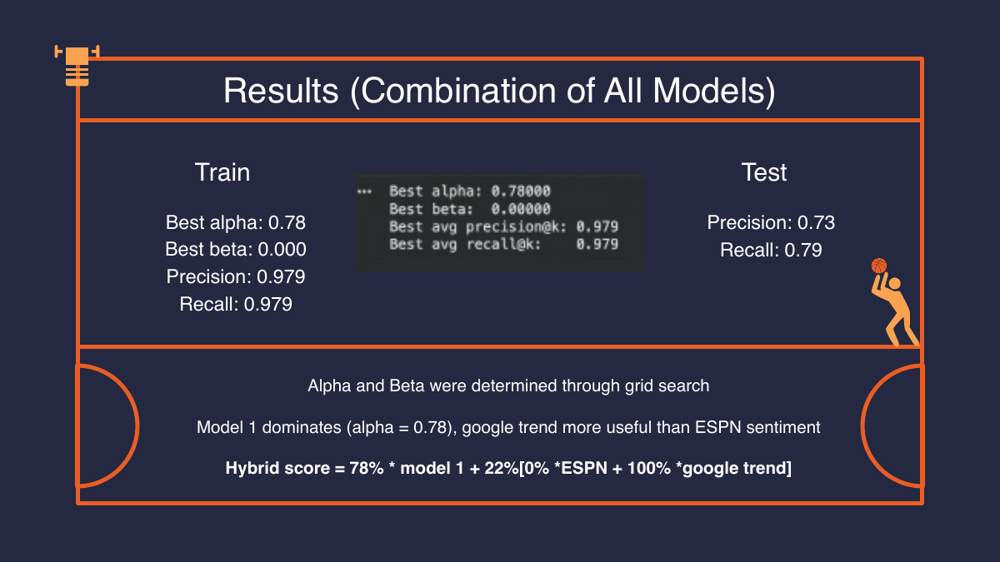
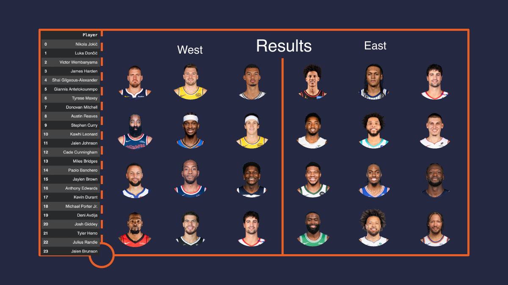
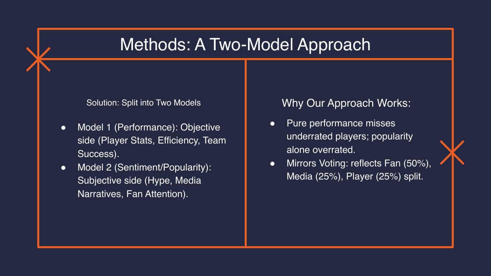

# NBA All-Star Roster Prediction

Who makes the NBA All-Star team? Stats alone don't decide it: starters are chosen by fans (50%), players (25%) and media (25%). We built a hybrid model that mirrors that vote, blending on-court performance with online popularity and media sentiment, and used it to predict the 2026 All-Star roster.



**Team:** Evelyn Ling, Ian Lin, Isaac Lei, Kai-Ying Chen, Millie You, Wharton Lin. Data 144 final project, Fall 2025.

## Results

We trained on the 2020–2023 All-Star selections and held out the **2024 All-Star Game** (2023–24 season) as an unseen test year.

| Model | Precision | Recall |
|---|---|---|
| Random guess (24 players at random) | 0.045 | 0.045 |
| **Hybrid model (top 26 picks)** | **0.73** | **0.79** |

On the held-out 2024 season, the model's top 26 picks included **19 of the 24 actual All-Stars**, with 7 false picks. On the training seasons the tuned blend reached 0.979 precision and recall.



### Predicted 2026 All-Stars

The 24 players our final notebook outputs for the 2025–26 season:

| West | East |
|---|---|
| Nikola Jokić | Giannis Antetokounmpo |
| Luka Dončić | Tyrese Maxey |
| Victor Wembanyama | Donovan Mitchell |
| James Harden | Jalen Johnson |
| Shai Gilgeous-Alexander | Cade Cunningham |
| Austin Reaves | Miles Bridges |
| Stephen Curry | Paolo Banchero |
| Kawhi Leonard | Jaylen Brown |
| Anthony Edwards | Michael Porter Jr. |
| Kevin Durant | Josh Giddey |
| Deni Avdija | Tyler Herro |
| Julius Randle | Jalen Brunson |



## How it works



**Model 1: performance (the objective side).** Season stats scraped from Basketball-Reference. Three classifiers each output an All-Star probability: logistic regression, a two-layer neural network and a random forest. We average the three. Only about 5% of players make the team, so we judged models on precision and recall instead of accuracy. To curb overfitting we dropped near-duplicate features (FG vs. PTS had r = 0.99), capped the random forest's depth at 5, and regularized and shrank the neural network.

**Model 2: popularity and sentiment (the subjective side).**
- *ESPN media sentiment:* the Google Custom Search API, restricted to espn.com/nba, pulls 10 analysis articles per player per season. NLTK scores their sentiment, and we combine that score with article volume.
- *Google Trends fan interest:* pytrends compares only 5 search terms at a time, so each batch of 4 players includes LeBron James as an anchor that puts everyone on one scale. Features: mean interest, interest over the last 30 days before voting, peak interest and trend slope.

**Final score:**

```
Final = α · Model 1 + (1 − α) · [ β · ESPN sentiment + (1 − β) · Google Trends ]
```

A grid search picked **α = 0.78** and **β = 0**. Performance carries most of the weight, and Google Trends popularity predicted selections better than ESPN sentiment did.

## Repository layout

```
Data144 Final Project_.pptx                full presentation, with speaker notes
Data144 Final Project.pdf                  the same deck as a PDF you can view on GitHub
NBA_Final_Prediction_Model.ipynb           combines both models, grid search, 2026 predictions
Model 1 (Statistic Model)/                 stats ensemble notebook and notes
Model 2 (Sentiment - Popularity Analysis)/ ESPN scraper, Google Trends notebooks and notes
Raw Data/                                  per-season player stats
Results - Prediction/                      model outputs read by the final notebook
General Document.docx                      project planning notes
assets/                                    slide images used in this README
```

## Running the notebooks

The notebooks were written in Google Colab and read their input CSVs by file name. Upload the files they need from `Raw Data/` and `Results - Prediction/` into the Colab session, or run them locally from the folder that holds those files.

```bash
pip install pandas numpy scikit-learn lightgbm matplotlib seaborn nltk pytrends requests opendatasets
```

The ESPN scraper reads a Google Custom Search API key from the `GOOGLE_API_KEY` environment variable.

## Limitations and next steps

- Our Reddit API application was rejected, and X (Twitter) search couldn't reach posts from before Nov 20, 2025. So fan interest comes from Google Trends rather than social posts.
- The 2024–25 season was skipped because its data format didn't match the other seasons.
- Next steps: gradient-boosted models (XGBoost, LightGBM), probability calibration, transformer-based sentiment, social-media engagement data, and a look at where fan popularity and performance disagree (underrated vs. overhyped players).
